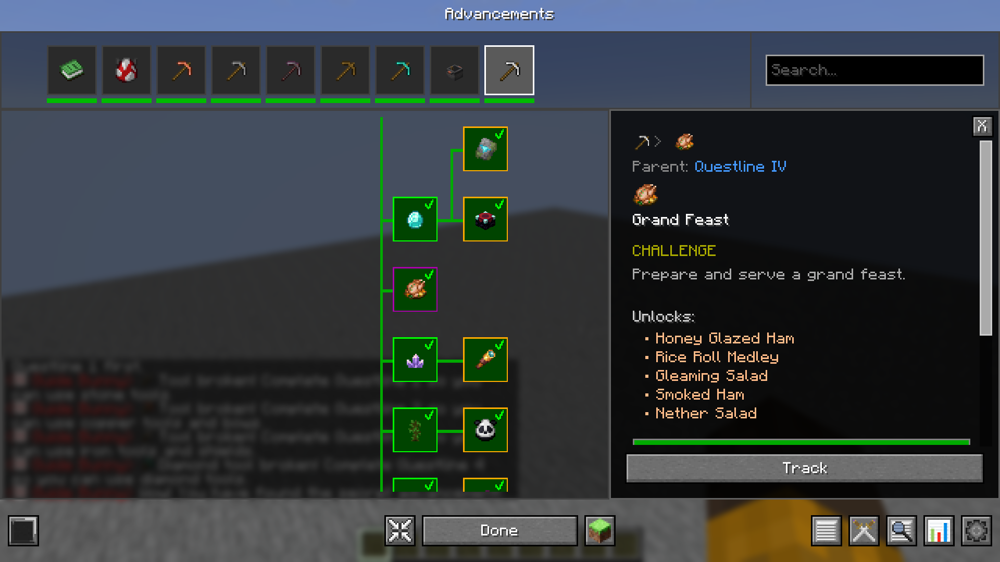
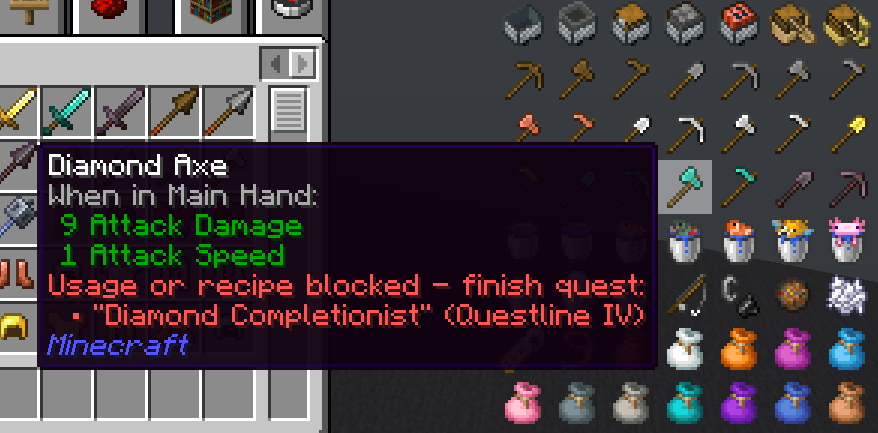
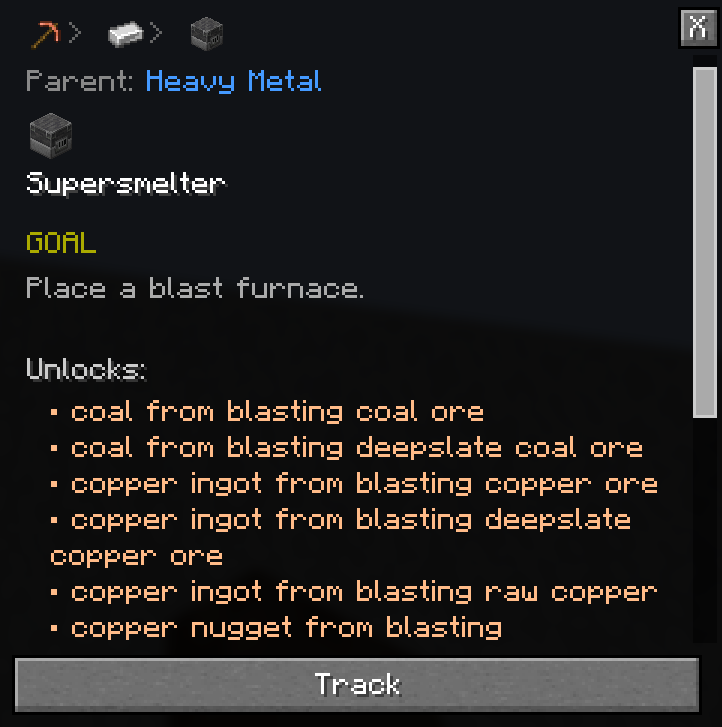

  <h1>
    Advancement Recipes
  </h1>
  <h3>A modern Fabric mod that locks crafting recipes behind questlines with full JEI integration.</h3>

   
  
   

## Overview

**Advancement Recipes** is a customized and extended Fabric mod fork of the original [Advancement Recipes datapack by huuue](https://modrinth.com/datapack/advancement-recipes), specially tailored for the **Essentia 3 Modpack** on modern versions of **Java Minecraft**.

It provides a cohesive, structured progression experience where recipes for vanilla items and key modded equipment are locked behind an interconnected advancement tree. Players unlock new tools, crafting stations, storage solutions, and automation components progressively as they explore biomes, mine deeper, and conquer dimensions.

## List of features

- **Advancement-Based Recipe Gating**:
  * Enforces the vanilla `limitedCrafting` gamerule automatically on world load to prevent crafting recipes before their quests are finished.
  * Over 2,000 vanilla and modded recipes are categorized across 7 distinct progression tiers.
  * Custom functions reward and synchronize recipe unlocks upon advancement completion.

- **Deep JEI (Just Enough Items) Integration**:
  * **Quest Status on Ingredients & Outputs**: Hovering over any recipe output or ingredient in JEI displays whether the item/recipe is unlocked or blocked, alongside the exact required quest name and questline category.
  * **Ingredient Info Pages**: Gated items include dedicated JEI description tabs explaining their progression requirements.
  * Works seamlessly in both singleplayer and multiplayer.

  

    
  

- **Modern Advancement Screen Compatibility**:
  * Integrates with **Modern Advancement Screen** to cleanly distinguish between actual rewards (XP, loot, functions) and recipe unlocks in advancement detail popups.

  

    
  

- **Extensive Mod Support**:
  * **Tom's Simple Storage Mod**:
    * Full recipe overhaul: crafted using logs instead of planks, redstone components (repeaters, comparators, torches), and gold.
    * Gated across late iron and diamond tiers (Questlines IV and V).
    * Built-in datapack overrides and automatic load ordering (`fabric:resource_load_order` & `PackRepository` sorting) guarantee custom recipes take priority in both new and existing worlds.
  * **Storage Drawers**:
    * Drawers and framing tables unlocked early in Questline I.
    * Upgrades seamlessly mapped across ore progression (Copper, Iron, Emerald, Gold, Redstone, Diamond, Netherite).
    * Compacting drawers unlocked at redstone tier; drawer controllers unlocked at diamond tier.
  * **Farmer's Delight**:
    * Culinary progression with tiered tools (knives, cooking pot, skillet) and grand feast recipes aligned with survival metal tiers.
  * **Nemo's Backpacks & Upgrade Templates**:
    * Progressive backpack tiers: Bundle -> Copper -> Iron -> Golden -> Diamond -> Netherite.
  * **Simple Magnets**:
    * Basic Magnet unlocked upon Iron Completionist; Demagnetization Coils and Advanced Magnets gated behind End exploration.
  * **Glow Paste**:
    * Unlocked via Swampland exploration; includes an alternative shapeless recipe combining honey bottles and clay balls into slimeballs.
  * **Essentialis**:
    * Hammer unlocked with iron blocks (Heavy Metal), Wayback Stone via Nether exploration, and the Chakram behind Ancient City exploration (Ruins Of Echo).
    * Netherite rings are upgraded alongside the rest of the netherite gear (Netherite Completionist); base rings stay ungated and appear as found loot.

- **Early-Game Progression Adjustments**:
  * Furnaces unlock immediately upon mining stone/cobblestone.
  * Basic storage containers (Chests, Barrels, early Drawers) are accessible early in the wood tier.
  * Copper Chests unlock alongside copper ingot mastery.

## Progression Tiers

1. **Tutorial**: Gathering logs, crafting table, dirt, and planting saplings.
2. **Questline I (Wood)**: Basic wood tools, shears, wool, farming, early storage (Chest, Barrel, Drawers).
3. **Questline II (Stone)**: Stone tools, furnace, hearty meals, bundle & early backpack, copper ingots & copper chest.
4. **Questline III (Copper)**: Iron mining, iron tools, anvil, cooking pot, skillet, iron upgrades & iron backpack.
5. **Questline IV (Iron)**: Nether portal, redstone, brewing, Tom's Storage networking & terminal, Storage Drawers compacting drawers, enchanting, diamonds!
6. **Questline V (Diamond)**: Tom's Storage crafting terminal & wireless terminal, drawer controller, netherite equipment, advanced magnets.
7. **Questline VI (End)**: Elytra, shulker portability, End cities, and end-game magnetics.

## Mod Compatibility & Requirements

- **Modpack**: [Essentia 3 Modpack](https://modrinth.com/modpack/essentia-3) (v1.1+)
- **Minecraft**: `26.3.X` (Fabric)
- **Dependencies**:
  * [Fabric Loader](https://fabricmc.net/) (>=0.19.0)
  * [Fabric API](https://modrinth.com/mod/fabric-api)
  * [JEI (Just Enough Items)](https://modrinth.com/mod/jei) (>=31.0.0)
  * [Modern Advancement Screen](https://modrinth.com/mod/modern-advancement-screen) (>=1.11.0)
  * [Tom's Simple Storage Mod](https://modrinth.com/mod/toms-storage)
  * [Storage Drawers](https://modrinth.com/mod/storagedrawers)
  * [Farmer's Delight [Refabricated]](https://modrinth.com/mod/farmers-delight)
  * [Nemo's Backpacks](https://modrinth.com/mod/nemos-backpacks) & [Upgrade Templates](https://modrinth.com/mod/nemos-upgrade-templates)
  * [Simple Magnets](https://modrinth.com/mod/simple-magnets)
  * [Glow Paste](https://modrinth.com/mod/glow-paste)
  * [Essentialis](https://github.com/amatsagu/essentialis) (=1.1-26.3.X), which requires [Trinkets Updated](https://modrinth.com/mod/trinkets-updated)

## Credits & License

- Forked and evolved from the original [Advancement Recipes datapack](https://modrinth.com/datapack/advancement-recipes) by **huuue**.
- Maintained, extended, and packaged for the **Essentia 3 Modpack** by **Amatsagu**.
- Licensed under the **MIT License**.